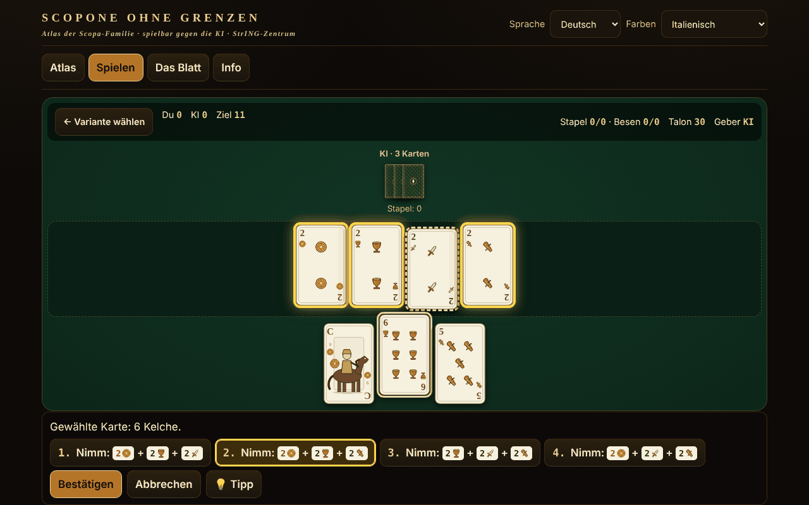

# Scopone fără frontiere

[English](README.md) · [Română](README.ro.md) · [Français](README.fr.md) · [Italiano](README.it.md) · [Español](README.es.md) · [Português](README.pt.md) · **Deutsch** · [Magyar](README.hu.md)

**Version:** 1.2.6 · **Zuletzt aktualisiert:** 2026-10-26

Oberflächensprachen: **Română, English, Français, Italiano, Español, Português (PT), Deutsch, Magyar**

Atlas der Scopa/Scopone-Familie mit dem italienischen 40-Karten-Blatt: 8 gegen die KI spielbare Varianten, in einer einzigen Offline-HTML-Datei.

**Online:** https://chiuta.github.io/Scopone-fara-frontiere/

## Was es ist

Ein Atlas (15 Datenblätter: Herkunft, Regeln, regionale Unterschiede, Näherungen, Quellen) und ein tatsächliches Spiel gegen einen lokalen KI-Gegner (heuristisch / Monte-Carlo, kein LLM). Die Farben (Denari, Coppe, Spade, Bastoni) sind in eigenem SVG gezeichnet, ohne regionale Blätter zu kopieren; es gibt auch einen Modus mit französischen Farben ♦♥♠♣ für alle, die das Blatt nicht kennen.

## Funktionen (im Code und in den Tests geprüft)

- Von der Oberfläche getrennte Engine (reine Funktionen: Zustand → legale Züge → neuer Zustand), in Node getestet.
- Erschöpfender Generator legaler Stiche (DFS mit Beschneidung), gegen brachiale 2^n-Aufzählung geprüft.
- Stichauswahl: Nach der Wahl einer Karte werden die möglichen Stiche vorab aufgelistet, die Karten auf dem Tisch hervorgehoben; bei mehreren Kombinationen wählen Sie; Sie können auch Karten auf dem Tisch ankreuzen (Validierung: Die Auswahl muss ein legaler Stich sein).
- Vollständige Tastaturbedienung: ← → Karten, Eingabe/Leertaste wählt aus, ↑ ↓ oder 1–9 wählen den Stich, Eingabe bestätigt, Esc bricht ab.
- **Hinweis (💡 / Taste H)** an Ihrer Reihe: hebt die Karte und den Stich hervor, die die einfache Heuristik der KI wählen würde, angewandt nur auf das, was Sie sehen (nicht auf die verdeckten Karten). Er nutzt einen separaten Zufallsgenerator, ändert also weder das Mischen noch die Züge der KI; er geht nicht in die Statistik ein und garantiert nicht den optimalen Zug. Die Texte sind in allen 8 Sprachen.
- Wertung: Scope, Karten, Denari, Settebello, Primiera (7=21, 6=18, Ass=16, 5=15, 4=14, 3=13, 2=12, Bilder=10; ohne eine Farbe gibt es keine Punkte), optional Re bello und Napola/Napoleone; Cirulla: Hand-/Geberboni, Piccola, Grande, Cappotto.
- Oberfläche in 8 Sprachen (RO/EN/FR/IT/ES/PT/DE/HU) mit automatischer Erkennung; lange Texte im Atlas: RO + EN (in FR/IT/ES/PT/DE/HU wird Englisch angezeigt, mit dem Hinweis „Text auf Englisch“). Die Schlüsselparität wird per Skript geprüft.
- Mischen mit `crypto.getRandomValues` (Rejection Sampling) oder reproduzierbarem Seed (mulberry32).
- Barrierefreiheit: aria-live, sichtbarer Fokus, Ziele ≥44 px (außer der festen Spenden-Pille in der Fußzeile, aus der Serie übernommen), Kontrast ≥4,5:1 (gemessen), `prefers-reduced-motion`, 390 px ohne horizontales Scrollen, `<noscript>`.

## Varianten

| Name | Spielbar? | ⚠ Näherungen |
|---|---|---|
| Scopa (2 Spieler) | ja | — (treu zu Pagat; „chiamarsi fuori“ fehlt) |
| Scopone 9 Karten + 4 auf dem Tisch (4 Spieler in Paaren) | ja | ⚠ nur der NAME ist zwischen den Quellen umstritten (siehe unten); die Regeln sind die aus den Quellen |
| Scopone 10 Karten, leerer Tisch (4 Spieler) — „scientifico“ bei Pagat/Aranzulla, „a 10 carte“ bei Wikipedia | ja | ⚠ nur der NAME ist umstritten; Scopa bei der letzten Karte: Option (standardmäßig nicht gezählt) |
| Scopa a 15 (Versionen a und b von Pagat; b = gleiche Karte, Satz gleichen Wertes oder Satz, der 15 ergibt) | ja | Version 3 und „Mindestkartenzahl“ nur im Atlas |
| Asso piglia tutto | ja | ⚠ bei mehreren Assen auf dem Tisch nimmt das Ass eines nach Wahl (Pagat sagt dazu nichts) |
| Scopa d'assi (4 Spieler, 10 Karten) | ja | ⚠ die Quellen unterscheiden sich in Details |
| Cirulla | ja | ⚠ Boni werden automatisch angesagt; Piccola/Grande nach nur einer Zusammenfassung |
| Rubamazzo | ja | ⚠ wechselnde regionale Regeln, einfache KI |
| Scopa Bazzica, scalette/Napola, Sbarazzina/Piva, Scopa corsa, Chkobba, Hurrikan, Cicera/Cirullone | nur im Atlas | — |

Zu den Namen: „9 Karten für jeden und leerer Tisch“ ist unmöglich (4×9=36). Es gibt zwei Spiele: 9 Karten + 4 auf dem Tisch und 10 Karten mit leerem Tisch. Pagat und ein italienischer Ratgeber (Aranzulla) nennen die Variante mit 10 Karten „Scopone scientifico“; die italienische und die englische Wikipedia nennen die Variante 9+4 „scientifico“ und die mit 10 „Scopone a 10 carte“. Deshalb beschriftet die Anwendung sie nach der Kartenzahl und kennzeichnet sie mit ⚠. Die Punkte pro Hand ergeben keine konstante Summe von 11; „11“ ist das Spielziel (optional 21).

## Bedienungsanleitung

1. Lesen Sie im Reiter „Atlas“ das Datenblatt einer Variante und drücken Sie „▶ Spielen“, oder gehen Sie zu „Spielen“.
2. Wählen Sie Variante, KI-Stufe, Ziel und Regeloptionen; leerer „Seed“ = zufälliges Mischen. „▶ Spiel beginnen“.
3. Wählen Sie an Ihrer Reihe eine Karte aus Ihrer Hand; die möglichen Stiche erscheinen unten und werden auf dem Tisch hervorgehoben. Wählen Sie einen (Klick, ↑↓ oder die Ziffer) und drücken Sie „Bestätigen“ / Eingabe. Gibt es keinen Stich, wird die Karte auf den Tisch gelegt. Der Stich ist Pflicht, wenn er möglich ist.
4. Am Ende der Hand erscheint die Punktetabelle; „Nächste Hand“ oder „Neues Spiel“.
5. Optional: „KI-Hände zeigen“ (nur zum Lernen) und „Gespielte Karten zeigen“ (Gedächtnisstütze).

## KI (ehrliche Beschreibung)

Es ist kein LLM. „Heuristisch“: Wert pro Zug + Schätzung des Scopa-Risikos aus den ungesehenen Karten. „Monte-Carlo“: Determinisierung (mögliche Verteilungen der ungesehenen Karten) + Simulationen mit heuristischer Strategie. Die KI erhält nur eine Beobachtung (den Tisch, die eigene Hand, die Stiche, die Kartenzahl der anderen): Der Test prüft, dass Beobachtungen und Entscheidungen identisch sind, wenn die verdeckten Karten permutiert werden. Gemessen (unabhängiges Audit, 40 Stichproben mit deterministischem Arbeitsbudget, Spiele mit wechselnden Sitzen, MC gegen Heuristik): Scopa 136/200 (68 % ±6,5), Scopone 9+4 103/160 (64 % ±7,4), Scopone 10 Karten 90/160 (56 % ±7,7 — Vorteil statistisch nicht nachgewiesen), Cirulla 100/150 (67 % ±7,5), Scopa d'assi 128/200 (64 % ±6,7), Scopa a 15 132/200 (66 % ±6,6), Asso piglia tutto 130/200 (65 % ±6,6; die letzten drei mit etwas größerem Budget); die Heuristik schlägt einen zufälligen Gegner bei Scopa 185/200. Es ist kein Spieler auf Turnierniveau. (Achtung: Mit 10 Stichproben pro Zug verlor MC bei Scopone — 38 % und 31 %; deshalb sind es jetzt bis zu 40, begrenzt durch ein Arbeitsbudget: in Chromium ~99 % der Züge unter ~115 ms, selten eine Spitze von ~200 ms.)

## Tests (außerhalb des Pakets)

53 Engine-Tests (darunter 500 KI-gegen-KI-Spiele in jeder der 7 Varianten mit bei jedem Schritt validierten Zügen, die 40-Karten-Invariante, Wertung im Vergleich mit einer unabhängigen Implementierung, 60 000 Vergleiche Generator gegen brachiale Aufzählung), 17 UI-Tests mit Playwright (vollständiges Spiel über die Oberfläche für jede Variante, CSP, Netzwerk, Mobil, Tastatur, Kontrast, blockiertes localStorage) und die i18n-Parität.

## Datenschutz und Netzwerk

Kein Netzwerk, kein Konto, keine Telemetrie; strenge CSP (`default-src 'none'`, Skript nur per SHA-256-Hash erlaubt, kein `connect-src`). `localStorage` (in try/catch) nur für Sprache, Kartenblatt, letzte Variante, lokale Statistik. Die Buy-Me-a-Coffee-Links in der Fußzeile öffnen sich nur beim Klicken (`rel=noopener`).

## Grenzen und Warnhinweise

- Die Regeln wurden bei Pagat.com, in der italienischen Wikipedia und in italienischen Ratgebern gelesen; das Regelwerk des italienischen Scopone-Verbandes konnte nicht eingesehen werden.
- Wo die Quellen abweichen (Namen Scopone/scientifico — geprüft bei Pagat, Aranzulla, Sisal, Wikipedia IT/EN; Ziel 11 gegenüber 21; Scopa bei der letzten Karte), sagt das Datenblatt, was implementiert wurde; die Optionen sind zugänglich.
- Cirulla und Rubamazzo haben ⚠ Näherungen; die KI ist nicht auf Turnierniveau.
- Die Karten sind Originalzeichnungen und bilden keine regionalen Blätter nach.

## Quellen

pagat.com/fishing/scopa.html · scopone.html · cirulla.html · it.wikipedia.org (Scopone scientifico, Rubamazzetto) · en.wikipedia.org (Scopone) · aranzulla.it (Scopone scientifico) · sisal.it (Scopone) · qualcherisposta.it (Rubamazzo).

## Lokale Ausführung

Laden Sie `index.html` herunter und öffnen Sie sie im Browser; sie funktioniert ohne Internet.

## Lizenz

MIT — siehe Datei LICENSE

## Autor

Alexio — Alexandru-Ionuț Chiuță · alexio@trom.tf

## Zusammenfassung

Offline-Atlas in einer einzigen Datei zur Scopa-/Scopone-Familie mit einem italienischen 40-Karten-Blatt (eigene SVG-Farben, Modus mit französischen Farben): 8 gegen eine lokale KI spielbare Varianten (Scopa, Scopone 9+4 ⚠Name, Scopone mit 10 Karten ⚠Name — die Quellen sind uneins, welches das „scientifico“ ist, Scopa a 15, Asso piglia tutto ⚠, Scopa d'assi ⚠, Cirulla ⚠, Rubamazzo ⚠), 7 nur im Atlas. Oberfläche in 8 Sprachen, lange Texte auf RO+EN. Ein erschöpfender Generator legaler Züge, gegen Brute-Force geprüft; 500 KI-gegen-KI-Partien pro Variante ohne Regelverstöße. Kein Netzwerk, keine Telemetrie. MIT-Lizenz.

## Neue Funktionen (v1.1.0)

- **Zwei-Spieler-Netzwerkspiel** (Schaltfläche „Zu zweit spielen, übers Netzwerk“): eine Scopone-Partie zwischen zwei Menschen, der Gastgeber hat Platz 0, der Gast Platz 1. Die Austeilung ist bei beiden identisch (gemeinsamer Seed), die Hand des Gegners bleibt verdeckt, Züge außer der Reihe werden abgelehnt, der KI-Hinweis ist abgeschaltet. Die Verbindung wird direkt zwischen den beiden Browsern hergestellt (WebRTC), ohne einen Server von uns: Sie tauschen zwei Texte aus (Angebot/Antwort), als Text oder QR-Code, über einen beliebigen Kanal Ihrer Wahl. Standardmäßig wird kein STUN-Server kontaktiert; ein STUN kann im Verbindungsfenster manuell eingegeben werden, nur wenn Sie es möchten (das ist der einzig mögliche Ausgang ins Netzwerk und erfolgt nur nach Ihrer Wahl). Wird die Verbindung unterbrochen, zeigt die Anwendung es an und kann das Spiel aus dem Zugprotokoll fortsetzen.
- **Vorlesen der Datenblätter** (Schaltfläche „Datenblatt anhören“ im Atlas): Titel, Herkunft und Regeln, über die Sprachsynthese des Browsers (FFF.tts), mit Stimmauswahl unter „Info“; ist keine Stimme vorhanden, erscheint eine Meldung, kein Fehler. Die langen Texte sind auf Englisch und werden daher mit englischer Stimme gelesen (in der Anwendung vermerkt).
- **Gemeinsames Kit** (core, label, bundle, p2p, qr, tts): das Versions-Label, .fff.json-Sicherung mit den lokalen Statistiken.
- Die neuen Texte sind in allen 8 Sprachen (ro, en, fr, it, es, pt, hu, de); die Übersetzungen fr/it/es/pt/hu/de sind automatisch und nicht muttersprachlich geprüft.
- Tests: `tests/fff-r8.test.mjs` (Playwright, Netzwerk blockiert, zwei Kontexte über den echten Dialog verbunden, axe 0 Verstöße bei 1280 und 360 px).

## Verlauf / Changelog

### 1.2.5 — 2026-10-23

- Die Schlüssel des lokalen Speichers verwenden jetzt das Präfix `scopone.` (`FFF.store.migrate` beim Start, vor jedem Lesezugriff): vorhandene Daten bleiben automatisch erhalten, alte `.fff.json`-Sicherungen lassen sich weiterhin importieren.

### 1.2.3 — 2026-10-22

fff-kit 1.1.4: Touch-Ziele und Mindestschriftgröße; Touch-Ziele und Text korrigiert.

### 1.2.2 — 2026-10-22
- fff-kit 1.1.2: PBKDF2 mit 600.000 Iterationen, Schutz vor Clickjacking

### 14. Oktober 2026 (v1.1.0)
- Neu: Zwei-Spieler-Netzwerkspiel (WebRTC, ohne Server), Vorlesen der Datenblätter, gemeinsames Kit (Label, .fff.json-Sicherung), 8 Sprachen für die neuen Funktionen, Tests.

### 12. Oktober 2026 (v1.0.0)
- 1.0.0 — 2026-10-12: Die Version und das Datum der letzten Aktualisierung werden in der Anwendung angezeigt

### 11. Oktober 2026
- Die Zeile unter der Variantenauswahl unter „Spielen“ zeigte in den anderen Sprachen die Spielerzahl auf Rumänisch („2 (3 oder 4 in Paaren: nur im Atlas)“) und ein doppeltes „⚠ ⚠“; sie ist jetzt in alle 7 Sprachen übersetzt, und bei Näherungen erscheint nur ein ⚠.
- Die Spenden-Pille („Unterstützen:“, ARIA-Beschriftungen, Titel) folgt jetzt der Sprache der Oberfläche (7 Sprachen) und bleibt nicht mehr auf Rumänisch.
- **Hinweis**-Schaltfläche (💡, Taste H) für den Zug des Spielers, in allen spielbaren Varianten (einschließlich Rubamazzo) und in 7 Sprachen.
- Die Beschriftungen im Atlas (der Filter „Alle“, die Spielerzahl, die Tags der Datenblätter, die ARIA-Beschriftungen) sind jetzt in alle 7 Sprachen übersetzt, ohne RO/EN-Mischung.
- Auf Bildschirmen ≤560 px ist die Spenden-Pille standardmäßig eine kleine ♥-Schaltfläche (sie klappt bei Berührung/Leertaste auf) und die Seite hat einen unteren Rand.
- Struktur: `nav` ohne Rolle `tablist` auf der Landmarke selbst (die Tablist liegt innen), `aside` für Spenden, Überschriften h1→h2 in der richtigen Reihenfolge, h1 auch in der Ansicht „Spielen“ (axe: 0 Verstöße in allen 4 Ansichten); der CSP-Hash des Skripts wurde neu berechnet.
