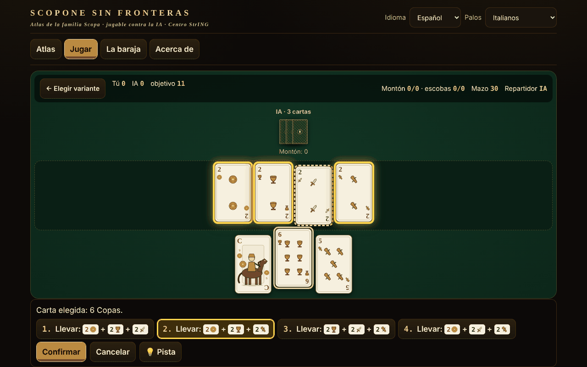

# Scopone fără frontiere

[English](README.md) · [Română](README.ro.md) · [Français](README.fr.md) · [Italiano](README.it.md) · **Español** · [Português](README.pt.md) · [Deutsch](README.de.md) · [Magyar](README.hu.md)

**Versión:** 1.2.0 · **Última actualización:** 2026-10-19

Idiomas de la interfaz: **Română, English, Français, Italiano, Español, Português (PT), Deutsch, Magyar**

Atlas de la familia Scopa/Scopone con la baraja italiana de 40 cartas: 8 variantes jugables contra la IA, en un solo archivo HTML sin conexión.

**En línea:** https://chiuta.github.io/Scopone-fara-frontiere/

## Qué es

Un atlas (15 fichas: origen, reglas, diferencias regionales, aproximaciones, fuentes) y un juego real contra un oponente de IA local (heurístico / Monte-Carlo, no un LLM). Los palos (Denari, Coppe, Spade, Bastoni) están dibujados en SVG propio, sin copiar barajas regionales; también hay un modo con palos franceses ♦♥♠♣ para quien no conoce la baraja.

## Funciones (verificadas en el código y las pruebas)

- Motor separado de la interfaz (funciones puras: estado → jugadas legales → estado nuevo), probado en Node.
- Generador exhaustivo de capturas legales (DFS con poda), verificado con enumeración por fuerza bruta 2^n.
- Selección de la captura: tras elegir una carta se preenumeran las capturas posibles y se resaltan las cartas de la mesa; si hay varias combinaciones eliges tú; también puedes marcar cartas de la mesa (validación: la selección debe ser una captura legal).
- Teclado completo: ← → cartas, Intro/Espacio selecciona, ↑ ↓ o 1–9 eligen la captura, Intro confirma, Esc cancela.
- **Sugerencia (💡 / tecla H)** en tu turno: resalta la carta y la captura que elegiría la heurística simple de la IA, aplicada solo a lo que tú ves (no a las cartas ocultas). Usa un generador aleatorio independiente, por lo que no cambia el barajado ni las jugadas de la IA; no entra en las estadísticas y no garantiza la jugada óptima. Los textos están en los 8 idiomas.
- Puntuación: escobas, cartas, denari, settebello, primiera (7=21, 6=18, As=16, 5=15, 4=14, 3=13, 2=12, figuras=10; sin un palo no se puntúa), opcionales Re bello y Napola/Napoleone; Cirulla: bonificaciones de mano/repartidor, piccola, grande, cappotto.
- Interfaz en 8 idiomas (RO/EN/FR/IT/ES/PT/DE/HU) con autodetección; textos largos del atlas: RO + EN (en FR/IT/ES/PT/DE/HU se muestra el inglés, con la nota «texto en inglés»). La paridad de claves se verifica con un script.
- Barajado con `crypto.getRandomValues` (muestreo por rechazo) o semilla reproducible (mulberry32).
- Accesibilidad: aria-live, foco visible, objetivos ≥44 px (salvo la píldora fija de donaciones del pie, copiada de la serie), contraste ≥4,5:1 (medido), `prefers-reduced-motion`, 390 px sin desplazamiento horizontal, `<noscript>`.

## Variantes

| Nombre | ¿Jugable? | ⚠ Aproximaciones |
|---|---|---|
| Scopa (2 jugadores) | sí | — (fiel a Pagat; falta «chiamarsi fuori») |
| Scopone 9 cartas + 4 en la mesa (4 jugadores en parejas) | sí | ⚠ solo el NOMBRE está discutido entre las fuentes (véase abajo); las reglas son las de las fuentes |
| Scopone 10 cartas, mesa vacía (4 jugadores) — «scientifico» en Pagat/Aranzulla, «a 10 carte» en Wikipedia | sí | ⚠ solo el NOMBRE está discutido; escoba en la última carta: opción (por defecto no cuenta) |
| Scopa a 15 (versiones a y b de Pagat; b = carta igual, conjunto del mismo valor o conjunto que suma 15) | sí | versión 3 y «mínimo de cartas» solo en el atlas |
| Asso piglia tutto | sí | ⚠ con varios ases en la mesa, el as toma uno a elección (Pagat no lo dice) |
| Scopa d'assi (4 jugadores, 10 cartas) | sí | ⚠ las fuentes difieren en los detalles |
| Cirulla | sí | ⚠ bonificaciones declaradas automáticamente; piccola/grande según un único resumen |
| Rubamazzo | sí | ⚠ reglas regionales variables, IA simple |
| Scopa Bazzica, scalette/Napola, Sbarazzina/Piva, Scopa corsa, Chkobba, Hurrikan, Cicera/Cirullone | solo en el atlas | — |

Sobre los nombres: «9 cartas cada uno y la mesa vacía» es imposible (4×9=36). Hay dos juegos: 9 cartas + 4 en la mesa y 10 cartas con la mesa vacía. Pagat y una guía italiana (Aranzulla) llaman «Scopone scientifico» a la variante de 10 cartas; la Wikipedia italiana e inglesa llaman «scientifico» a la variante 9+4 y «Scopone a 10 carte» a la de 10. Por eso la aplicación las etiqueta por el número de cartas y las marca con ⚠. Los puntos por mano no suman un total constante de 11; «11» es el objetivo del juego (opcionalmente 21).

## Manual de uso

1. Desde la pestaña «Atlas» lee la ficha de una variante y pulsa «▶ Jugar», o ve a «Jugar».
2. Elige la variante, el nivel de la IA, el objetivo, las opciones de regla; «Seed» vacío = barajado aleatorio. «▶ Empezar la partida».
3. En tu turno elige una carta de tu mano; las capturas posibles aparecen abajo y se resaltan en la mesa. Elige una (clic, ↑↓ o el dígito) y pulsa «Confirmar» / Intro. Si no hay captura, la carta se deja en la mesa. La captura es obligatoria cuando es posible.
4. Al final de la mano aparece la tabla de puntos; «Mano siguiente» o «Partida nueva».
5. Opcional: «Mostrar las manos de la IA» (solo para aprender) y «Mostrar las cartas jugadas» (ayuda de memoria).

## IA (descripción honesta)

No es un LLM. «Heurístico»: valor por jugada + estimación del riesgo de escoba a partir de las cartas no vistas. «Monte-Carlo»: determinización (posibles distribuciones de las cartas no vistas) + simulaciones con política heurística. La IA recibe solo una observación (la mesa, su propia mano, las bazas, el número de cartas de los demás): la prueba verifica que las observaciones y las decisiones son idénticas cuando se permutan las cartas ocultas. Medido (auditoría independiente, 40 muestras con presupuesto de trabajo determinista, partidas con asientos alternados, MC contra heurístico): Scopa 136/200 (68 % ±6,5), Scopone 9+4 103/160 (64 % ±7,4), Scopone 10 cartas 90/160 (56 % ±7,7 — ventaja no demostrada estadísticamente), Cirulla 100/150 (67 % ±7,5), Scopa d'assi 128/200 (64 % ±6,7), Scopa a 15 132/200 (66 % ±6,6), Asso piglia tutto 130/200 (65 % ±6,6; las tres últimas con un presupuesto algo mayor); el heurístico vence a un oponente aleatorio 185/200 en Scopa. No es un jugador de nivel de torneo. (Atención: con 10 muestras por jugada, MC perdía en Scopone — 38 % y 31 %; por eso ahora son hasta 40, limitadas por un presupuesto de trabajo: en Chromium ~99 % de las jugadas por debajo de ~115 ms, rara vez un pico de ~200 ms.)

## Pruebas (fuera del paquete)

53 pruebas del motor (incluidas 500 partidas IA contra IA en cada una de las 7 variantes con jugadas validadas en cada paso, el invariante de las 40 cartas, puntuación comparada con una implementación independiente, 60 000 comparaciones generador contra enumeración por fuerza bruta), 17 pruebas de interfaz con Playwright (partida completa a través de la interfaz para cada variante, CSP, red, móvil, teclado, contraste, localStorage bloqueado) y la paridad i18n.

## Privacidad y red

Sin red, cuenta ni telemetría; CSP estricta (`default-src 'none'`, script permitido solo por hash SHA-256, sin `connect-src`). `localStorage` (en try/catch) solo para el idioma, la baraja, la última variante y las estadísticas locales. Los enlaces de Buy Me a Coffee del pie solo se abren al hacer clic (`rel=noopener`).

## Límites y advertencias

- Las reglas se leyeron en Pagat.com, la Wikipedia italiana y guías italianas; no se pudo consultar el reglamento de la Federación Italiana de Scopone.
- Donde las fuentes difieren (nombres Scopone/scientifico — verificados en Pagat, Aranzulla, Sisal, Wikipedia IT/EN; objetivo 11 frente a 21; escoba en la última carta) la ficha dice lo que se implementó; las opciones están expuestas.
- Cirulla y Rubamazzo tienen aproximaciones ⚠; la IA no es de torneo.
- Las cartas son dibujos originales, no reproducen barajas regionales.

## Fuentes

pagat.com/fishing/scopa.html · scopone.html · cirulla.html · it.wikipedia.org (Scopone scientifico, Rubamazzetto) · en.wikipedia.org (Scopone) · aranzulla.it (Scopone scientifico) · sisal.it (Scopone) · qualcherisposta.it (Rubamazzo).

## Ejecución local

Descarga `index.html` y ábrelo en el navegador; funciona sin internet.

## Licencia

MIT — véase el archivo LICENSE

## Autor

Alexio — Alexandru-Ionuț Chiuță · alexio@trom.tf

## Resumen

Atlas sin conexión, de un único archivo, de la familia Scopa/Scopone con una baraja italiana de 40 cartas (palos SVG originales, modo de baraja francesa): 8 variantes jugables contra una IA local (Scopa, Scopone 9+4 ⚠nombre, Scopone de 10 cartas ⚠nombre — las fuentes discrepan sobre cuál es el «scientifico», Scopa a 15, Asso piglia tutto ⚠, Scopa d'assi ⚠, Cirulla ⚠, Rubamazzo ⚠), 7 solo en el atlas. Interfaz en 8 idiomas, textos largos en RO+EN. Generador exhaustivo de capturas legales verificado contra fuerza bruta; 500 partidas IA contra IA por variante sin infracciones. Sin red, sin telemetría. Licencia MIT.

## Novedades (v1.1.0)

- **Partida de dos en red** (botón «Jugar de dos, en red»): una partida de Scopone entre dos personas, el anfitrión tiene el asiento 0, el invitado el asiento 1. El reparto es idéntico para ambos (semilla común), la mano del oponente permanece oculta, las jugadas fuera de turno se rechazan, la sugerencia de la IA está desactivada. La conexión se hace directamente entre los dos navegadores (WebRTC), sin servidor nuestro: intercambias dos textos (oferta/respuesta), como texto o código QR, por cualquier canal que elijas. Por defecto no se contacta con ningún servidor STUN; se puede introducir un STUN manualmente en la ventana de conexión, solo si lo quieres (es la única salida posible hacia la red y se produce solo por tu elección). Si el enlace se interrumpe, la aplicación lo muestra y puede reanudar la partida desde el registro de jugadas.
- **Lectura en voz alta de las fichas** (botón «Escuchar la ficha» en el atlas): título, origen y reglas, mediante la síntesis de voz del navegador (FFF.tts), con selector de voz en «Acerca de»; si no hay voz, aparece un mensaje, no un error. Los textos largos están en inglés, por lo que se leen con voz inglesa (indicado en la aplicación).
- **Kit común** (core, label, bundle, p2p, qr, tts): la etiqueta de versión, copia de seguridad .fff.json con las estadísticas locales.
- Los textos nuevos están en los 8 idiomas (ro, en, fr, it, es, pt, hu, de); las traducciones fr/it/es/pt/hu/de son automáticas y no verificadas por nativos.
- Pruebas: `tests/fff-r8.test.mjs` (Playwright, red bloqueada, dos contextos conectados mediante el cuadro de diálogo real, axe 0 infracciones a 1280 y 360 px).

## Historial / Changelog

### 14 de octubre de 2026 (v1.1.0)
- Nuevo: partida de dos en red (WebRTC, sin servidor), lectura en voz alta de las fichas, kit común (etiqueta, copia .fff.json), 8 idiomas para las funciones nuevas, pruebas.

### 12 de octubre de 2026 (v1.0.0)
- 1.0.0 — 2026-10-12: la versión y la fecha de la última actualización se muestran en la aplicación

### 11 de octubre de 2026
- La línea bajo el selector de variante en «Jugar» mostraba el número de jugadores en rumano en los otros idiomas («2 (3 o 4 en parejas: solo en el atlas)») y un doble «⚠ ⚠»; ahora está traducida a los 7 idiomas y aparece un solo ⚠ en las aproximaciones.
- La píldora de donaciones («Apoya:», etiquetas ARIA, títulos) sigue ahora el idioma de la interfaz (7 idiomas), ya no se queda en rumano.
- Botón de **sugerencia** (💡, tecla H) para la jugada del jugador, en todas las variantes jugables (incluido Rubamazzo) y en 7 idiomas.
- Las etiquetas del atlas (el filtro «Todas», el número de jugadores, las etiquetas de las fichas, las etiquetas ARIA) están ahora traducidas a los 7 idiomas, sin mezcla RO/EN.
- En pantallas ≤560 px la píldora de donaciones es por defecto un pequeño botón ♥ (se expande al tocar/Espacio) y la página tiene margen inferior.
- Estructura: `nav` sin rol `tablist` en el propio punto de referencia (el tablist está dentro), `aside` para las donaciones, títulos h1→h2 en orden, h1 también en la vista «Jugar» (axe: 0 infracciones en las 4 vistas); el hash CSP del script se recalculó.
