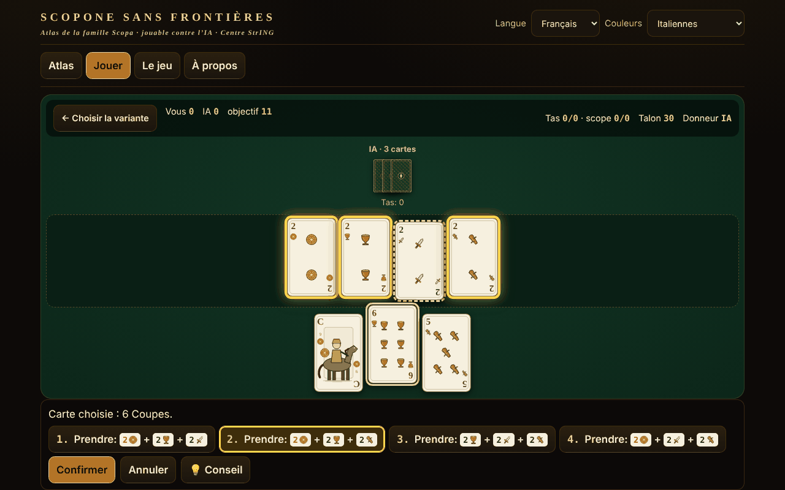

# Scopone fără frontiere

[English](README.md) · [Română](README.ro.md) · **Français** · [Italiano](README.it.md) · [Español](README.es.md) · [Português](README.pt.md) · [Deutsch](README.de.md) · [Magyar](README.hu.md)

**Version :** 2.0.1 · **Dernière mise à jour :** 2026-10-27

Langues de l'interface : **Română, English, Français, Italiano, Español, Português (PT), Deutsch, Magyar**

Atlas de la famille Scopa/Scopone avec le jeu italien de 40 cartes : 8 variantes jouables contre une IA, dans un seul fichier HTML hors ligne.

**En ligne :** https://chiuta.github.io/Scopone-fara-frontiere/

## De quoi s'agit-il

Un atlas (15 fiches : origine, règles, différences régionales, approximations, sources) et un vrai jeu contre un adversaire IA local (heuristique / Monte-Carlo, pas un LLM). Les enseignes (Denari, Coppe, Spade, Bastoni) sont dessinées en SVG propre, sans copier de jeux régionaux ; il existe aussi un mode avec enseignes françaises ♦♥♠♣ pour ceux qui ne connaissent pas le jeu.

## Fonctionnalités (vérifiées dans le code et les tests)

- Moteur séparé de l'interface (fonctions pures : état → coups légaux → nouvel état), testé sous Node.
- Générateur exhaustif de prises légales (DFS avec élagage), vérifié par énumération brute 2^n.
- Choix de la prise : après avoir choisi une carte, les prises possibles sont pré-listées et les cartes de la table sont mises en évidence ; s'il y a plusieurs combinaisons, vous choisissez ; vous pouvez aussi cocher des cartes sur la table (validation : la sélection doit être une prise légale).
- Clavier complet : ← → cartes, Entrée/Espace sélectionne, ↑ ↓ ou 1–9 choisissent la prise, Entrée confirme, Échap annule.
- **Suggestion (💡 / touche H)** à votre tour : met en évidence la carte et la prise que choisirait l'heuristique simple de l'IA, appliquée uniquement à ce que vous voyez (pas aux cartes cachées). Elle utilise un générateur aléatoire distinct, donc ne change ni le mélange ni les coups de l'IA ; elle n'entre pas dans les statistiques et ne garantit pas le coup optimal. Les textes sont dans les 8 langues.
- Décompte : scope, cartes, denari, settebello, primiera (7=21, 6=18, As=16, 5=15, 4=14, 3=13, 2=12, figures=10 ; sans une enseigne, pas de point), en option Re bello et Napola/Napoleone ; Cirulla : bonus de main/donneur, piccola, grande, cappotto.
- Interface en 8 langues (RO/EN/FR/IT/ES/PT/DE/HU) avec détection automatique ; textes longs de l'atlas : RO + EN (en FR/IT/ES/PT/DE/HU l'anglais s'affiche, avec la mention « texte en anglais »). La parité des clés est vérifiée par script.
- Mélange avec `crypto.getRandomValues` (échantillonnage par rejet) ou graine reproductible (mulberry32).
- Accessibilité : aria-live, focus visible, cibles ≥44 px (sauf la pastille de dons fixe du pied de page, copiée de la série), contraste ≥4,5:1 (mesuré), `prefers-reduced-motion`, 390 px sans défilement horizontal, `<noscript>`.

## Variantes

| Nom | Jouable ? | ⚠ Approximations |
|---|---|---|
| Scopa (2 joueurs) | oui | — (fidèle à Pagat ; « chiamarsi fuori » manque) |
| Scopone 9 cartes + 4 sur la table (4 joueurs par paires) | oui | ⚠ seul le NOM est contesté entre les sources (voir ci-dessous) ; les règles sont celles des sources |
| Scopone 10 cartes, table vide (4 joueurs) — « scientifico » chez Pagat/Aranzulla, « a 10 carte » chez Wikipédia | oui | ⚠ seul le NOM est contesté ; scopa à la dernière carte : option (par défaut non comptée) |
| Scopa a 15 (versions a et b de Pagat ; b = carte égale, ensemble de même valeur ou ensemble qui fait 15) | oui | version 3 et « minimum de cartes » seulement dans l'atlas |
| Asso piglia tutto | oui | ⚠ avec plusieurs as sur la table, l'as en prend un au choix (Pagat ne le dit pas) |
| Scopa d'assi (4 joueurs, 10 cartes) | oui | ⚠ les sources diffèrent dans les détails |
| Cirulla | oui | ⚠ bonus déclarés automatiquement ; piccola/grande d'après un seul résumé |
| Rubamazzo | oui | ⚠ règles régionales variables, IA simple |
| Scopa Bazzica, scalette/Napola, Sbarazzina/Piva, Scopa corsa, Chkobba, Hurrikan, Cicera/Cirullone | atlas seulement | — |

À propos des noms : « 9 cartes chacun et la table vide » est impossible (4×9=36). Il existe deux jeux : 9 cartes + 4 sur la table et 10 cartes avec la table vide. Pagat et un guide italien (Aranzulla) appellent « Scopone scientifico » la variante à 10 cartes ; Wikipédia en italien et en anglais appellent « scientifico » la variante 9+4 et « Scopone a 10 carte » celle à 10 cartes. C'est pourquoi l'application les étiquette selon le nombre de cartes et les marque ⚠. Les points par main n'additionnent pas un total constant de 11 ; « 11 » est l'objectif du jeu (en option 21).

## Mode d'emploi

1. Dans l'onglet « Atlas », lisez la fiche d'une variante et appuyez sur « ▶ Jouer », ou allez dans « Jouer ».
2. Choisissez la variante, le niveau de l'IA, l'objectif, les options de règle ; « Seed » vide = mélange aléatoire. « ▶ Commencer la partie ».
3. À votre tour, choisissez une carte de votre main ; les prises possibles apparaissent en bas et sont mises en évidence sur la table. Choisissez-en une (clic, ↑↓ ou le chiffre) et appuyez sur « Confirmer » / Entrée. S'il n'y a pas de prise, la carte est posée sur la table. La prise est obligatoire quand elle est possible.
4. À la fin de la main, le tableau des points apparaît ; « Main suivante » ou « Nouvelle partie ».
5. Facultatif : « Montrer les mains de l'IA » (apprentissage seulement) et « Montrer les cartes sorties » (aide-mémoire).

## IA (description honnête)

Ce n'est pas un LLM. « Heuristique » : valeur par coup + estimation du risque de scopa à partir des cartes non vues. « Monte-Carlo » : déterminisation (distributions possibles des cartes non vues) + simulations avec une politique heuristique. L'IA ne reçoit qu'une observation (la table, sa propre main, les plis, le nombre de cartes des autres) : le test vérifie que les observations et les décisions sont identiques quand les cartes cachées sont permutées. Mesuré (audit indépendant, 40 échantillons avec budget de travail déterministe, parties avec places alternées, MC contre heuristique) : Scopa 136/200 (68 % ±6,5), Scopone 9+4 103/160 (64 % ±7,4), Scopone 10 cartes 90/160 (56 % ±7,7 — avantage non démontré statistiquement), Cirulla 100/150 (67 % ±7,5), Scopa d'assi 128/200 (64 % ±6,7), Scopa a 15 132/200 (66 % ±6,6), Asso piglia tutto 130/200 (65 % ±6,6 ; les trois derniers avec un budget un peu plus grand) ; l'heuristique bat un adversaire aléatoire 185/200 à la Scopa. Ce n'est pas un joueur de niveau tournoi. (Attention : avec 10 échantillons par coup, MC perdait au Scopone — 38 % et 31 % ; c'est pourquoi il y en a maintenant jusqu'à 40, limités par un budget de travail : dans Chromium ~99 % des coups sous ~115 ms, rarement un pic de ~200 ms.)

## Tests (hors du paquet)

53 tests de moteur (dont 500 parties IA contre IA sur chacune des 7 variantes avec coups validés à chaque étape, l'invariant des 40 cartes, score comparé à une implémentation indépendante, 60 000 comparaisons générateur contre énumération brute), 17 tests d'interface Playwright (partie complète via l'interface pour chaque variante, CSP, réseau, mobile, clavier, contraste, localStorage bloqué) et la parité i18n.

## Confidentialité et réseau

Sans réseau, compte ni télémétrie ; CSP stricte (`default-src 'none'`, script autorisé uniquement par hash SHA-256, sans `connect-src`). `localStorage` (dans un try/catch) uniquement pour la langue, le jeu de cartes, la dernière variante, les statistiques locales. Les liens Buy Me a Coffee du pied de page ne s'ouvrent qu'au clic (`rel=noopener`).

## Limites et avertissements

- Les règles ont été lues sur Pagat.com, Wikipédia en italien et des guides italiens ; le règlement de la Fédération italienne de Scopone n'a pas pu être consulté.
- Là où les sources diffèrent (noms Scopone/scientifico — vérifiés chez Pagat, Aranzulla, Sisal, Wikipédia IT/EN ; objectif 11 contre 21 ; scopa à la dernière carte), la fiche dit ce qui a été implémenté ; les options sont exposées.
- Cirulla et Rubamazzo ont des approximations ⚠ ; l'IA n'est pas de niveau tournoi.
- Les cartes sont des dessins originaux, qui ne reproduisent pas de jeux régionaux.

## Sources

pagat.com/fishing/scopa.html · scopone.html · cirulla.html · it.wikipedia.org (Scopone scientifico, Rubamazzetto) · en.wikipedia.org (Scopone) · aranzulla.it (Scopone scientifico) · sisal.it (Scopone) · qualcherisposta.it (Rubamazzo).

## Exécution locale

Téléchargez `index.html` et ouvrez-le dans un navigateur ; il fonctionne sans Internet.

## Licence

MIT — voir le fichier LICENSE

## Auteur

Alexio — Alexandru-Ionuț Chiuță · alexio@trom.tf

## Résumé

Atlas hors ligne, en un seul fichier, de la famille Scopa/Scopone avec un jeu italien de 40 cartes (couleurs SVG originales, mode couleurs françaises) : 8 variantes jouables contre une IA locale (Scopa, Scopone 9+4 ⚠nom, Scopone à 10 cartes ⚠nom — les sources ne s'accordent pas sur celle qui est « scientifico », Scopa a 15, Asso piglia tutto ⚠, Scopa d'assi ⚠, Cirulla ⚠, Rubamazzo ⚠), 7 réservées à l'atlas. Interface en 8 langues, longs textes en RO+EN. Générateur exhaustif des prises légales vérifié par force brute ; 500 parties IA contre IA par variante sans violation. Pas de réseau, pas de télémétrie. Licence MIT.

## Nouveautés (v1.1.0)

- **Partie à deux en réseau** (bouton « Jouer à deux, en réseau ») : une partie de Scopone entre deux humains, l'hôte a la place 0, l'invité la place 1. La donne est identique chez les deux (graine commune), la main de l'adversaire reste cachée, les coups hors tour sont rejetés, la suggestion de l'IA est désactivée. La connexion se fait directement entre les deux navigateurs (WebRTC), sans serveur de notre part : vous échangez deux textes (offre/réponse), sous forme de texte ou de code QR, par le canal de votre choix. Par défaut, aucun serveur STUN n'est contacté ; un STUN peut être saisi manuellement dans la fenêtre de connexion, uniquement si vous le souhaitez (c'est la seule sortie possible vers le réseau et elle n'a lieu qu'à votre choix). Si la liaison est interrompue, l'application l'indique et peut reprendre la partie à partir du journal des coups.
- **Lecture à voix haute des fiches** (bouton « Écouter la fiche » dans l'atlas) : titre, origine et règles, via la synthèse vocale du navigateur (FFF.tts), avec un sélecteur de voix dans « À propos » ; s'il n'y a pas de voix, un message s'affiche, pas une erreur. Les textes longs sont en anglais, donc lus avec une voix anglaise (indiqué dans l'application).
- **Kit commun** (core, label, bundle, p2p, qr, tts) : l'étiquette de version, la sauvegarde .fff.json avec les statistiques locales.
- Les nouveaux textes sont dans les 8 langues (ro, en, fr, it, es, pt, hu, de) ; les traductions fr/it/es/pt/hu/de sont automatiques et non vérifiées par des natifs.
- Tests : `tests/fff-r8.test.mjs` (Playwright, réseau bloqué, deux contextes connectés par la vraie boîte de dialogue, axe 0 violation à 1280 et 360 px).

## Historique / Changelog

### 1.2.5 — 2026-10-23

- Les clés du stockage local utilisent désormais le préfixe `scopone.` (`FFF.store.migrate` au démarrage, avant toute lecture) : les données existantes sont conservées automatiquement et les anciennes sauvegardes `.fff.json` restent importables.

### 1.2.3 — 2026-10-22

fff-kit 1.1.4 : cibles tactiles et taille de texte minimale; cibles tactiles et texte corrigés.

### 1.2.2 — 2026-10-22
- fff-kit 1.1.2 : PBKDF2 à 600 000 itérations, protection anti-clickjacking

### 14 octobre 2026 (v1.1.0)
- Nouveau : partie à deux en réseau (WebRTC, sans serveur), lecture à voix haute des fiches, kit commun (étiquette, sauvegarde .fff.json), 8 langues pour les nouvelles fonctions, tests.

### 12 octobre 2026 (v1.0.0)
- 1.0.0 — 2026-10-12 : la version et la date de la dernière mise à jour s'affichent dans l'application

### 11 octobre 2026
- La ligne sous le sélecteur de variante dans « Jouer » affichait le nombre de joueurs en roumain dans les autres langues (« 2 (3 ou 4 par paires : atlas seulement) ») et un double « ⚠ ⚠ » ; elle est maintenant traduite dans les 7 langues, et un seul ⚠ apparaît pour les approximations.
- La pastille de dons (« Soutenir : », étiquettes ARIA, titres) suit désormais la langue de l'interface (7 langues), et ne reste plus en roumain.
- Bouton de **suggestion** (💡, touche H) pour le coup du joueur, dans toutes les variantes jouables (y compris Rubamazzo) et en 7 langues.
- Les étiquettes de l'atlas (le filtre « Tous », le nombre de joueurs, les tags de fiche, les étiquettes ARIA) sont maintenant traduites dans les 7 langues, sans mélange RO/EN.
- Sur les écrans ≤560 px, la pastille de dons est par défaut un petit bouton ♥ (il s'étend au toucher/Espace) et la page a une marge basse.
- Structure : `nav` sans rôle `tablist` sur le repère lui-même (le tablist est à l'intérieur), `aside` pour les dons, titres h1→h2 dans l'ordre, h1 aussi dans la vue « Jouer » (axe : 0 violation dans les 4 vues) ; le hash CSP du script a été recalculé.
