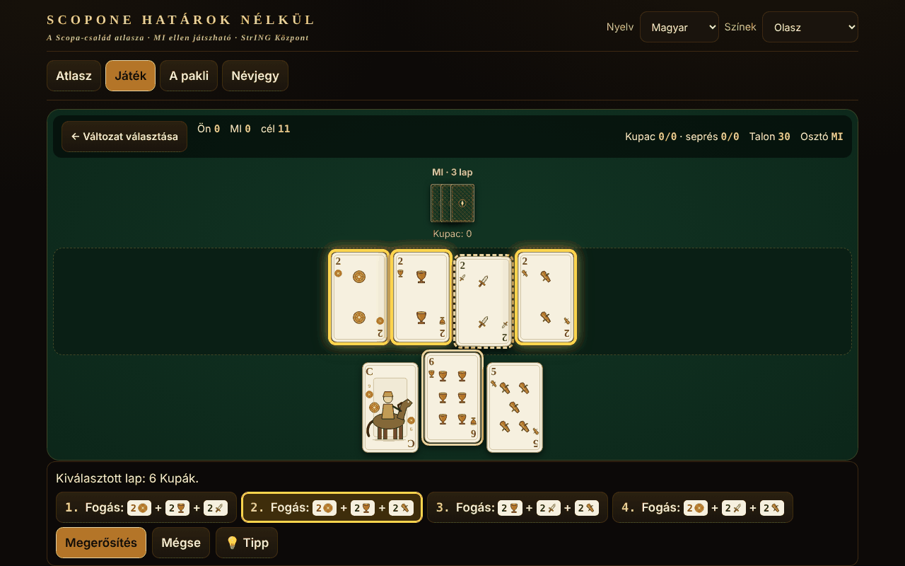

# Scopone fără frontiere

[English](README.md) · [Română](README.ro.md) · [Français](README.fr.md) · [Italiano](README.it.md) · [Español](README.es.md) · [Português](README.pt.md) · [Deutsch](README.de.md) · **Magyar**

**Verzió:** 1.2.1 · **Utolsó frissítés:** 2026-10-19

A felület nyelvei: **Română, English, Français, Italiano, Español, Português (PT), Deutsch, Magyar**

A Scopa/Scopone család atlasza az olasz 40 lapos paklival: 8 MI ellen játszható változat egyetlen offline HTML-fájlban.

**Élő változat:** https://chiuta.github.io/Scopone-fara-frontiere/

## Mi ez

Egy atlasz (15 lap: eredet, szabályok, regionális különbségek, közelítések, források) és egy tényleges játék helyi MI-ellenfél ellen (heurisztikus / Monte-Carlo, nem LLM). A színek (Denari, Coppe, Spade, Bastoni) saját SVG-ben vannak megrajzolva, regionális paklik másolása nélkül; létezik francia színjelekkel (♦♥♠♣) működő mód is azoknak, akik nem ismerik a paklit.

## Funkciók (a kódban és a tesztekben ellenőrizve)

- A felülettől különálló motor (tiszta függvények: állapot → szabályos lépések → új állapot), Node-ban tesztelve.
- Szabályos ütések kimerítő generátora (DFS nyesessel), nyers 2^n felsorolással ellenőrizve.
- Az ütés kiválasztása: egy lap kiválasztása után a lehetséges ütések előre fel vannak sorolva, az asztalon lévő lapok kiemelve; több kombináció esetén Ön választ; az asztalon lévő lapokat be is jelölheti (érvényesítés: a kijelölésnek szabályos ütésnek kell lennie).
- Teljes billentyűzetkezelés: ← → lapok, Enter/Szóköz kijelöl, ↑ ↓ vagy 1–9 az ütést választja, Enter megerősít, Esc megszakít.
- **Tipp (💡 / H billentyű)** az Ön körében: kiemeli azt a lapot és ütést, amelyet az MI egyszerű heurisztikája választana, kizárólag arra alkalmazva, amit Ön lát (a rejtett lapokra nem). Külön véletlengenerátort használ, így nem változtatja meg a keverést vagy az MI lépéseit; nem kerül be a statisztikába, és nem garantálja az optimális lépést. A szövegek mind a 8 nyelven elérhetők.
- Pontozás: scope, lapok, denari, settebello, primiera (7=21, 6=18, Ász=16, 5=15, 4=14, 3=13, 2=12, figurák=10; egy szín hiányában nincs pont), opcionálisan Re bello és Napola/Napoleone; Cirulla: kéz-/osztóbónuszok, piccola, grande, cappotto.
- Felület 8 nyelven (RO/EN/FR/IT/ES/PT/DE/HU) automatikus felismeréssel; az atlasz hosszú szövegei: RO + EN (FR/IT/ES/PT/DE/HU nyelven az angol jelenik meg, a „szöveg angolul” megjegyzéssel). A kulcsok paritását szkript ellenőrzi.
- Keverés `crypto.getRandomValues`-szal (elutasításos mintavételezés) vagy reprodukálható maggal (mulberry32).
- Akadálymentesség: aria-live, látható fókusz, ≥44 px célterületek (a láblécben lévő fix adománycsík kivételével, amely a sorozatból van átmásolva), kontraszt ≥4,5:1 (mérve), `prefers-reduced-motion`, 390 px vízszintes görgetés nélkül, `<noscript>`.

## Változatok

| Név | Játszható? | ⚠ Közelítések |
|---|---|---|
| Scopa (2 játékos) | igen | — (hű a Pagathoz; a „chiamarsi fuori” hiányzik) |
| Scopone 9 lap + 4 az asztalon (4 játékos párokban) | igen | ⚠ csak a NÉV vitatott a források között (lásd lent); a szabályok a forrásokból származnak |
| Scopone 10 lap, üres asztal (4 játékos) — „scientifico” a Pagatnál/Aranzullánál, „a 10 carte” a Wikipédián | igen | ⚠ csak a NÉV vitatott; scopa az utolsó lapra: opció (alapértelmezés szerint nem számít) |
| Scopa a 15 (a Pagat a és b változata; b = azonos lap, azonos értékű halmaz vagy 15-öt kitevő halmaz) | igen | a 3. változat és a „minimális lapszám” csak az atlaszban |
| Asso piglia tutto | igen | ⚠ több ász esetén az asztalon az ász egyet visz tetszés szerint (a Pagat nem mondja meg) |
| Scopa d'assi (4 játékos, 10 lap) | igen | ⚠ a források részletekben eltérnek |
| Cirulla | igen | ⚠ a bónuszok automatikusan bemondva; piccola/grande egyetlen összefoglaló alapján |
| Rubamazzo | igen | ⚠ változó regionális szabályok, egyszerű MI |
| Scopa Bazzica, scalette/Napola, Sbarazzina/Piva, Scopa corsa, Chkobba, Hurrikan, Cicera/Cirullone | csak az atlaszban | — |

A nevekről: a „mindenkinek 9 lap és üres asztal” lehetetlen (4×9=36). Két játék létezik: 9 lap + 4 az asztalon, és 10 lap üres asztallal. A Pagat és egy olasz útmutató (Aranzulla) a 10 lapos változatot nevezi „Scopone scientifico”-nak; az olasz és az angol Wikipédia a 9+4 változatot nevezi „scientifico”-nak, a 10 lapost pedig „Scopone a 10 carte”-nak. Ezért az alkalmazás a lapok száma szerint címkézi őket, és ⚠ jellel látja el. A kézenkénti pontok nem adnak ki állandó 11-es összeget; a „11” a játék célpontja (opcionálisan 21).

## Használati útmutató

1. Az „Atlasz” fülön olvassa el egy változat lapját, és nyomja meg a „▶ Játék” gombot, vagy lépjen a „Játék” részre.
2. Válassza ki a változatot, az MI szintjét, a célt és a szabályopciókat; üres „Seed” = véletlen keverés. „▶ Meccs indítása”.
3. A saját körében válasszon egy lapot a kezéből; a lehetséges ütések alul jelennek meg, és az asztalon ki vannak emelve. Válasszon egyet (kattintás, ↑↓ vagy a számjegy), és nyomja meg a „Megerősítés” gombot / Entert. Ha nincs ütés, a lap az asztalra kerül. Az ütés kötelező, ha lehetséges.
4. A kéz végén megjelenik a pontszámtábla; „Következő kéz” vagy „Új meccs”.
5. Opcionális: „Az MI kezeinek mutatása” (csak tanuláshoz) és „A kijött lapok mutatása” (memóriasegéd).

## MI (őszinte leírás)

Nem LLM. „Heurisztikus”: lépésenkénti érték + a scopa-kockázat becslése a nem látott lapokból. „Monte-Carlo”: determinizálás (a nem látott lapok lehetséges eloszlásai) + szimulációk heurisztikus politikával. Az MI csak egy megfigyelést kap (az asztalt, saját kezét, az ütéseket, a többiek lapjainak számát): a teszt ellenőrzi, hogy a megfigyelések és a döntések azonosak, ha a rejtett lapokat permutálják. Mérve (független audit, 40 minta determinisztikus munkakerettel, váltott helyekkel játszott meccsek, MC a heurisztika ellen): Scopa 136/200 (68% ±6,5), Scopone 9+4 103/160 (64% ±7,4), Scopone 10 lap 90/160 (56% ±7,7 — az előny statisztikailag nem igazolt), Cirulla 100/150 (67% ±7,5), Scopa d'assi 128/200 (64% ±6,7), Scopa a 15 132/200 (66% ±6,6), Asso piglia tutto 130/200 (65% ±6,6; az utolsó három kissé nagyobb kerettel); a heurisztika 185/200 arányban veri a véletlenszerű ellenfelet Scopában. Nem versenyszintű játékos. (Figyelem: lépésenként 10 mintával az MC vesztett a Scopone-ban — 38% és 31%; ezért most legfeljebb 40 van, munkakerettel korlátozva: Chromiumban a lépések ~99%-a ~115 ms alatt, ritkán ~200 ms-os csúcs.)

## Tesztek (a csomagon kívül)

53 motorteszt (köztük 500 MI–MI meccs a 7 változat mindegyikén, minden lépésben érvényesített lépésekkel, a 40 lapos invariáns, a pontszám összevetése egy független implementációval, 60 000 összehasonlítás generátor vs. nyers felsorolás), 17 Playwright felületi teszt (teljes meccs a felületen át minden változatra, CSP, hálózat, mobil, billentyűzet, kontraszt, blokkolt localStorage) és az i18n-paritás.

## Adatvédelem és hálózat

Hálózat, fiók vagy telemetria nélkül; szigorú CSP (`default-src 'none'`, szkript csak SHA-256 hash alapján engedélyezett, `connect-src` nélkül). `localStorage` (try/catch-ben) csak a nyelvhez, a pakli típusához, az utolsó változathoz és a helyi statisztikákhoz. A láblécben lévő Buy Me a Coffee hivatkozások csak kattintásra nyílnak meg (`rel=noopener`).

## Korlátok és figyelmeztetések

- A szabályokat a Pagat.com, az olasz Wikipédia és olasz útmutatók alapján olvasták; az Olasz Scopone Szövetség szabályzatát nem lehetett megtekinteni.
- Ahol a források eltérnek (Scopone/scientifico elnevezések — ellenőrizve a Pagatnál, Aranzullánál, Sisalnál, az IT/EN Wikipédián; a 11 vs. 21 cél; scopa az utolsó lapra), a lap megmondja, mi lett megvalósítva; az opciók elérhetők.
- A Cirulla és a Rubamazzo ⚠ közelítéseket tartalmaz; az MI nem versenyszintű.
- A lapok eredeti rajzok, nem reprodukálnak regionális paklikat.

## Források

pagat.com/fishing/scopa.html · scopone.html · cirulla.html · it.wikipedia.org (Scopone scientifico, Rubamazzetto) · en.wikipedia.org (Scopone) · aranzulla.it (Scopone scientifico) · sisal.it (Scopone) · qualcherisposta.it (Rubamazzo).

## Helyi futtatás

Töltse le az `index.html` fájlt, és nyissa meg böngészőben; internet nélkül működik.

## Licenc

MIT — lásd a LICENSE fájlt

## Szerző

Alexio — Alexandru-Ionuț Chiuță · alexio@trom.tf

## Összefoglaló
Egyfájlos, offline atlasz a Scopa/Scopone családról 40 lapos olasz paklival (saját SVG színek, francia színű mód): 8 változat játszható helyi MI ellen (Scopa, Scopone 9+4 ⚠név, Scopone 10 lapos ⚠név — a források nem értenek egyet abban, hogy melyik a „scientifico”, Scopa a 15, Asso piglia tutto ⚠, Scopa d'assi ⚠, Cirulla ⚠, Rubamazzo ⚠), 7 csak az atlaszban szerepel. Felület 8 nyelven, a hosszú szövegek RO+EN. A teljes körű szabályos ütéskereső generátort nyers erővel ellenőriztük; változatonként 500 MI–MI játszma szabálysértés nélkül. Hálózat és telemetria nélkül. MIT licenc.

## Újdonságok (v1.1.0)

- **Kétszemélyes hálózati játék** („Játék kettesben, hálózaton” gomb): egy Scopone-meccs két ember között, a házigazdának a 0., a vendégnek az 1. hely jut. Az osztás mindkettőjüknél azonos (közös mag), az ellenfél keze rejtett marad, a soron kívüli lépéseket elutasítja, az MI-tipp ki van kapcsolva. A kapcsolat közvetlenül a két böngésző között jön létre (WebRTC), a mi szerverünk nélkül: két szöveget cserél (ajánlat/válasz), szövegként vagy QR-kódként, az Ön által választott csatornán. Alapértelmezés szerint semmilyen STUN-szerverrel nem veszi fel a kapcsolatot; STUN a kapcsolódási ablakban kézzel megadható, csak ha Ön akarja (ez az egyetlen lehetséges kijárat a hálózatra, és csak az Ön döntésére történik). Ha a kapcsolat megszakad, az alkalmazás jelzi, és a lépésnaplóból folytathatja a játékot.
- **A lapok felolvasása** („Lap meghallgatása” gomb az atlaszban): cím, eredet és szabályok, a böngésző beszédszintézisén keresztül (FFF.tts), hangválasztóval a „Névjegy” alatt; ha nincs hang, üzenet jelenik meg, nem hiba. A hosszú szövegek angolul vannak, ezért angol hanggal olvashatók fel (az alkalmazásban jelezve).
- **Közös kit** (core, label, bundle, p2p, qr, tts): a verziócímke, .fff.json biztonsági mentés a helyi statisztikákkal.
- Az új szövegek mind a 8 nyelven (ro, en, fr, it, es, pt, hu, de) elérhetők; az fr/it/es/pt/hu/de fordítások automatikusak, és anyanyelvi ellenőrzés nélküliek.
- Tesztek: `tests/fff-r8.test.mjs` (Playwright, hálózat blokkolva, két, a valódi párbeszédablakon át összekapcsolt környezet, axe 0 szabálysértés 1280 és 360 px-en).

## Előzmények / Changelog

### 2026. október 14. (v1.1.0)
- Új: kétszemélyes hálózati játék (WebRTC, szerver nélkül), a lapok felolvasása, közös kit (címke, .fff.json mentés), 8 nyelv az új funkciókhoz, tesztek.

### 2026. október 12. (v1.0.0)
- 1.0.0 — 2026-10-12: a verzió és az utolsó frissítés dátuma megjelenik az alkalmazásban

### 2026. október 11.
- A „Játék” részben a változatválasztó alatti sor a többi nyelven románul mutatta a játékosok számát („2 (3 vagy 4 párokban: csak az atlaszban)”) és dupla „⚠ ⚠” jelet; mostantól mind a 7 nyelvre le van fordítva, és közelítéseknél csak egyetlen ⚠ jelenik meg.
- Az adománycsík („Támogasson:”, ARIA-feliratok, címek) mostantól a felület nyelvét követi (7 nyelv), nem marad románul.
- **Tipp** gomb (💡, H billentyű) a játékos lépéséhez, minden játszható változatban (a Rubamazzót is beleértve) és 7 nyelven.
- Az atlasz feliratai (a „Mind” szűrő, a játékosok száma, a lapcímkék, az ARIA-feliratok) mostantól mind a 7 nyelvre le vannak fordítva, RO/EN keveredés nélkül.
- ≤560 px-es képernyőkön az adománycsík alapértelmezés szerint kis ♥ gomb (érintésre/Szóközre kinyílik), és az oldalnak alsó margója van.
- Szerkezet: `nav` `tablist` szerepkör nélkül magán az eligazodási ponton (a tablist belül van), `aside` az adományokhoz, h1→h2 címsorok sorrendben, h1 a „Játék” nézetben is (axe: 0 szabálysértés mind a 4 nézetben); a szkript CSP-hashét újraszámolták.
