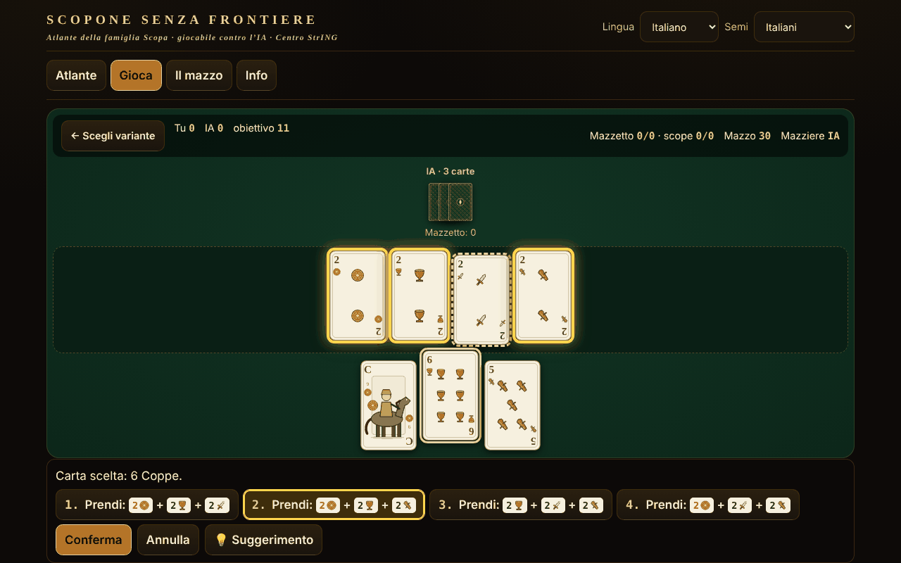

# Scopone fără frontiere

[English](README.md) · [Română](README.ro.md) · [Français](README.fr.md) · **Italiano** · [Español](README.es.md) · [Português](README.pt.md) · [Deutsch](README.de.md) · [Magyar](README.hu.md)

**Versione:** 2.0.1 · **Ultimo aggiornamento:** 2026-10-27

Lingue dell'interfaccia: **Română, English, Français, Italiano, Español, Português (PT), Deutsch, Magyar**

Atlante della famiglia Scopa/Scopone con il mazzo italiano da 40 carte: 8 varianti giocabili contro l'IA, in un unico file HTML offline.

**Online:** https://chiuta.github.io/Scopone-fara-frontiere/

## Cos'è

Un atlante (15 schede: origine, regole, differenze regionali, approssimazioni, fonti) e un vero gioco contro un avversario IA locale (euristico / Monte-Carlo, non un LLM). I semi (Denari, Coppe, Spade, Bastoni) sono disegnati in SVG originale, senza copiare mazzi regionali; esiste anche la modalità con semi francesi ♦♥♠♣ per chi non conosce il mazzo.

## Funzioni (verificate nel codice e nei test)

- Motore separato dall'interfaccia (funzioni pure: stato → mosse legali → nuovo stato), testato in Node.
- Generatore esaustivo di prese legali (DFS con potatura), verificato con enumerazione a forza bruta 2^n.
- Selezione della presa: dopo aver scelto una carta si pre-elencano le prese possibili, le carte sul tavolo sono evidenziate; se ci sono più combinazioni scegli tu; puoi anche spuntare carte sul tavolo (validazione: la selezione deve essere una presa legale).
- Tastiera completa: ← → carte, Invio/Spazio seleziona, ↑ ↓ o 1–9 scelgono la presa, Invio conferma, Esc annulla.
- **Suggerimento (💡 / tasto H)** al tuo turno: evidenzia la carta e la presa che sceglierebbe l'euristica semplice dell'IA, applicata solo a ciò che vedi tu (non alle carte nascoste). Usa un generatore casuale separato, quindi non cambia il mescolamento né le mosse dell'IA; non entra nelle statistiche e non garantisce la mossa ottimale. I testi sono in tutte e 8 le lingue.
- Punteggio: scope, carte, denari, settebello, primiera (7=21, 6=18, Asso=16, 5=15, 4=14, 3=13, 2=12, figure=10; senza un seme non si conteggia), opzionali Re bello e Napola/Napoleone; Cirulla: bonus di mano/mazziere, piccola, grande, cappotto.
- Interfaccia in 8 lingue (RO/EN/FR/IT/ES/PT/DE/HU) con rilevamento automatico; testi lunghi dell'atlante: RO + EN (in FR/IT/ES/PT/DE/HU si mostra l'inglese, con la nota «testo in inglese»). La parità delle chiavi è verificata con uno script.
- Mescolamento con `crypto.getRandomValues` (rejection sampling) o seme riproducibile (mulberry32).
- Accessibilità: aria-live, focus visibile, bersagli ≥44 px (tranne la pillola fissa delle donazioni nel piè di pagina, copiata dalla serie), contrasto ≥4,5:1 (misurato), `prefers-reduced-motion`, 390 px senza scorrimento orizzontale, `<noscript>`.

## Varianti

| Nome | Giocabile? | ⚠ Approssimazioni |
|---|---|---|
| Scopa (2 giocatori) | sì | — (fedele a Pagat; manca «chiamarsi fuori») |
| Scopone 9 carte + 4 sul tavolo (4 giocatori a coppie) | sì | ⚠ solo il NOME è contestato tra le fonti (vedi sotto); le regole sono quelle delle fonti |
| Scopone 10 carte, tavolo vuoto (4 giocatori) — «scientifico» per Pagat/Aranzulla, «a 10 carte» per Wikipedia | sì | ⚠ solo il NOME è contestato; scopa all'ultima carta: opzione (di default non conta) |
| Scopa a 15 (versioni a e b da Pagat; b = carta uguale, insieme dello stesso valore o insieme che fa 15) | sì | versione 3 e «minimo di carte» solo nell'atlante |
| Asso piglia tutto | sì | ⚠ con più assi sul tavolo, l'asso ne prende uno a scelta (Pagat non lo dice) |
| Scopa d'assi (4 giocatori, 10 carte) | sì | ⚠ le fonti differiscono nei dettagli |
| Cirulla | sì | ⚠ bonus dichiarati automaticamente; piccola/grande da un solo riassunto |
| Rubamazzo | sì | ⚠ regole regionali variabili, IA semplice |
| Scopa Bazzica, scalette/Napola, Sbarazzina/Piva, Scopa corsa, Chkobba, Hurrikan, Cicera/Cirullone | solo nell'atlante | — |

Sui nomi: «9 carte ciascuno e tavolo vuoto» è impossibile (4×9=36). Esistono due giochi: 9 carte + 4 sul tavolo e 10 carte con tavolo vuoto. Pagat e una guida italiana (Aranzulla) chiamano «Scopone scientifico» la variante con 10 carte; Wikipedia in italiano e in inglese chiamano «scientifico» la variante 9+4 e «Scopone a 10 carte» quella con 10. Per questo l'applicazione le etichetta secondo il numero di carte e le contrassegna con ⚠. I punti per mano non sommano un totale costante di 11; «11» è l'obiettivo del gioco (opzionalmente 21).

## Guida all'uso

1. Dalla scheda «Atlante» leggi la scheda di una variante e premi «▶ Gioca», oppure vai in «Gioca».
2. Scegli la variante, il livello dell'IA, l'obiettivo, le opzioni di regola; «Seed» vuoto = mescolamento casuale. «▶ Inizia la partita».
3. Al tuo turno scegli una carta dalla mano; le prese possibili compaiono in basso e si evidenziano sul tavolo. Scegline una (clic, ↑↓ o la cifra) e premi «Conferma» / Invio. Se non c'è presa, la carta viene posata sul tavolo. La presa è obbligatoria quando è possibile.
4. A fine mano compare la tabella dei punti; «Mano successiva» o «Nuova partita».
5. Opzionale: «Mostra le mani dell'IA» (solo apprendimento) e «Mostra le carte uscite» (aiuto alla memoria).

## IA (descrizione onesta)

Non è un LLM. «Euristico»: valore per mossa + stima del rischio di scopa dalle carte non viste. «Monte-Carlo»: determinizzazione (possibili distribuzioni delle carte non viste) + simulazioni con politica euristica. L'IA riceve solo un'osservazione (il tavolo, la propria mano, le prese, il numero di carte degli altri): il test verifica che osservazioni e decisioni siano identiche quando le carte nascoste vengono permutate. Misurato (audit indipendente, 40 campioni con budget di lavoro deterministico, partite con posti alternati, MC contro euristico): Scopa 136/200 (68% ±6,5), Scopone 9+4 103/160 (64% ±7,4), Scopone 10 carte 90/160 (56% ±7,7 — vantaggio non dimostrato statisticamente), Cirulla 100/150 (67% ±7,5), Scopa d'assi 128/200 (64% ±6,7), Scopa a 15 132/200 (66% ±6,6), Asso piglia tutto 130/200 (65% ±6,6; gli ultimi tre con un budget leggermente maggiore); l'euristico batte un avversario casuale 185/200 a Scopa. Non è un giocatore da torneo. (Attenzione: con 10 campioni per mossa, MC perdeva a Scopone — 38% e 31%; per questo ora sono fino a 40, limitati da un budget di lavoro: in Chromium ~99% delle mosse sotto ~115 ms, raramente un picco di ~200 ms.)

## Test (fuori dal pacchetto)

53 test del motore (incluse 500 partite IA contro IA su ciascuna delle 7 varianti con mosse validate a ogni passo, l'invariante delle 40 carte, punteggio confrontato con un'implementazione indipendente, 60.000 confronti generatore contro enumerazione a forza bruta), 17 test UI Playwright (partita completa tramite UI per ogni variante, CSP, rete, mobile, tastiera, contrasto, localStorage bloccato) e la parità i18n.

## Privacy e rete

Senza rete, account né telemetria; CSP rigorosa (`default-src 'none'`, script consentito solo tramite hash SHA-256, senza `connect-src`). `localStorage` (in try/catch) solo per lingua, mazzo, ultima variante, statistiche locali. I link Buy Me a Coffee nel piè di pagina si aprono solo al clic (`rel=noopener`).

## Limiti e avvertenze

- Le regole sono state lette da Pagat.com, Wikipedia in italiano e guide italiane; il regolamento della Federazione Italiana Scopone non ha potuto essere consultato.
- Dove le fonti differiscono (nomi Scopone/scientifico — verificati su Pagat, Aranzulla, Sisal, Wikipedia IT/EN; obiettivo 11 contro 21; scopa all'ultima carta) la scheda dice cosa è stato implementato; le opzioni sono esposte.
- Cirulla e Rubamazzo hanno approssimazioni ⚠; l'IA non è da torneo.
- Le carte sono disegni originali, non riproducono mazzi regionali.

## Fonti

pagat.com/fishing/scopa.html · scopone.html · cirulla.html · it.wikipedia.org (Scopone scientifico, Rubamazzetto) · en.wikipedia.org (Scopone) · aranzulla.it (Scopone scientifico) · sisal.it (Scopone) · qualcherisposta.it (Rubamazzo).

## Esecuzione locale

Scarica `index.html` e aprilo nel browser; funziona senza Internet.

## Licenza

MIT — vedi il file LICENSE

## Autore

Alexio — Alexandru-Ionuț Chiuță · alexio@trom.tf

## Riepilogo

Atlante offline in un unico file della famiglia Scopa/Scopone con un mazzo italiano da 40 carte (semi SVG originali, modalità con semi francesi): 8 varianti giocabili contro un'IA locale (Scopa, Scopone 9+4 ⚠nome, Scopone a 10 carte ⚠nome — le fonti non concordano su quale sia lo «scientifico», Scopa a 15, Asso piglia tutto ⚠, Scopa d'assi ⚠, Cirulla ⚠, Rubamazzo ⚠), 7 solo nell'atlante. Interfaccia in 8 lingue, testi lunghi in RO+EN. Generatore esaustivo delle prese legali verificato con la forza bruta; 500 partite IA contro IA per variante senza violazioni. Nessuna rete, nessuna telemetria. Licenza MIT.

## Novità (v1.1.0)

- **Partita a due in rete** (pulsante «Gioca in due, in rete»): una partita di Scopone tra due persone, l'host ha il posto 0, l'ospite il posto 1. La distribuzione è identica per entrambi (seme comune), la mano dell'avversario resta nascosta, le mosse fuori turno sono rifiutate, il suggerimento dell'IA è disattivato. La connessione avviene direttamente tra i due browser (WebRTC), senza un nostro server: scambi due testi (offerta/risposta), come testo o codice QR, attraverso qualsiasi canale scelto da te. Di default non si contatta alcun server STUN; uno STUN può essere inserito manualmente nella finestra di connessione, solo se lo vuoi (è l'unica uscita possibile verso la rete e avviene solo per tua scelta). Se il collegamento si interrompe, l'applicazione lo mostra e può riprendere la partita dal registro delle mosse.
- **Lettura ad alta voce delle schede** (pulsante «Ascolta la scheda» nell'atlante): titolo, origine e regole, tramite la sintesi vocale del browser (FFF.tts), con selettore di voce in «Informazioni»; se non c'è una voce, compare un messaggio, non un errore. I testi lunghi sono in inglese, quindi si leggono con voce inglese (indicato nell'applicazione).
- **Kit comune** (core, label, bundle, p2p, qr, tts): l'etichetta di versione, copia di sicurezza .fff.json con le statistiche locali.
- I nuovi testi sono in tutte e 8 le lingue (ro, en, fr, it, es, pt, hu, de); le traduzioni fr/it/es/pt/hu/de sono automatiche e non verificate da madrelingua.
- Test: `tests/fff-r8.test.mjs` (Playwright, rete bloccata, due contesti collegati tramite la vera finestra di dialogo, axe 0 violazioni a 1280 e 360 px).

## Storico / Changelog

### 1.2.5 — 2026-10-23

- Le chiavi dell'archiviazione locale usano ora il prefisso `scopone.` (`FFF.store.migrate` all'avvio, prima di qualsiasi lettura): i dati esistenti vengono conservati automaticamente e i vecchi backup `.fff.json` si possono ancora importare.

### 1.2.3 — 2026-10-22

fff-kit 1.1.4: target touch e dimensione minima del testo; target touch e testo corretti.

### 1.2.2 — 2026-10-22
- fff-kit 1.1.2: PBKDF2 con 600.000 iterazioni, protezione anti-clickjacking

### 14 ottobre 2026 (v1.1.0)
- Novità: partita a due in rete (WebRTC, senza server), lettura ad alta voce delle schede, kit comune (etichetta, copia .fff.json), 8 lingue per le nuove funzioni, test.

### 12 ottobre 2026 (v1.0.0)
- 1.0.0 — 2026-10-12: la versione e la data dell'ultimo aggiornamento sono mostrate nell'applicazione

### 11 ottobre 2026
- La riga sotto il selettore di variante in «Gioca» mostrava il numero di giocatori in rumeno nelle altre lingue («2 (3 o 4 a coppie: solo nell'atlante)») e un doppio «⚠ ⚠»; ora è tradotta in tutte e 7 le lingue e compare un solo ⚠ per le approssimazioni.
- La pillola delle donazioni («Sostieni:», etichette ARIA, titoli) segue ora la lingua dell'interfaccia (7 lingue), non resta più in rumeno.
- Pulsante di **suggerimento** (💡, tasto H) per la mossa del giocatore, in tutte le varianti giocabili (incluso Rubamazzo) e in 7 lingue.
- Le etichette dell'atlante (il filtro «Tutte», il numero di giocatori, i tag delle schede, le etichette ARIA) sono ora tradotte in tutte e 7 le lingue, senza miscela RO/EN.
- Sugli schermi ≤560 px la pillola delle donazioni è di default un piccolo pulsante ♥ (si espande al tocco/Spazio) e la pagina ha un margine in basso.
- Struttura: `nav` senza ruolo `tablist` sul punto di riferimento stesso (il tablist è all'interno), `aside` per le donazioni, titoli h1→h2 in ordine, h1 anche nella vista «Gioca» (axe: 0 violazioni in tutte e 4 le viste); l'hash CSP dello script è stato ricalcolato.
