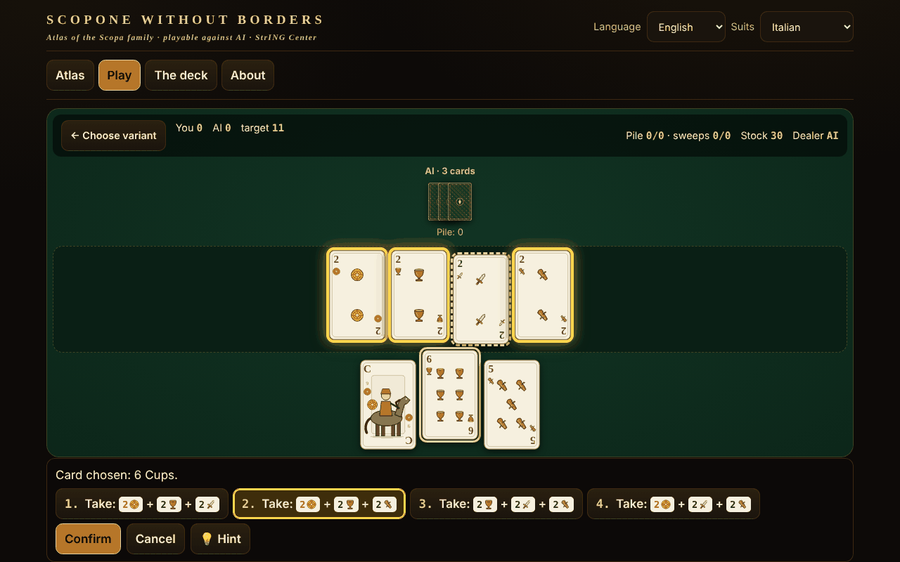

# Scopone fără frontiere

**English** · [Română](README.ro.md) · [Français](README.fr.md) · [Italiano](README.it.md) · [Español](README.es.md) · [Português](README.pt.md) · [Deutsch](README.de.md) · [Magyar](README.hu.md)

**Version:** 1.2.4 · **Last updated:** 2026-10-23

Interface languages: **Română, English, Français, Italiano, Español, Português (PT), Deutsch, Magyar**

An atlas of the Scopa/Scopone family with the 40-card Italian deck: 8 variants playable against an AI, in a single offline HTML file.

**Live:** https://chiuta.github.io/Scopone-fara-frontiere/

## What it is

An atlas (15 sheets: origin, rules, regional differences, approximations, sources) and an actual game against a local AI opponent (heuristic / Monte-Carlo, not an LLM). The suits (Denari, Coppe, Spade, Bastoni) are drawn in our own SVG, without copying regional decks; there is also a mode with French suits ♦♥♠♣ for those who do not know the deck.

## Features (verified in code and tests)

- Engine separate from the interface (pure functions: state → legal moves → new state), tested in Node.
- Exhaustive generator of legal captures (DFS with pruning), verified against brute-force 2^n enumeration.
- Capture selection: after choosing a card, the possible captures are pre-listed and the cards on the table are highlighted; if there are several combinations you choose; you can also tick cards on the table (validation: the selection must be a legal capture).
- Full keyboard: ← → cards, Enter/Space selects, ↑ ↓ or 1–9 choose the capture, Enter confirms, Esc cancels.
- **Hint (💡 / H key)** on your turn: highlights the card and the capture that the AI's simple heuristic would choose, applied only to what you can see (not to hidden cards). It uses a separate random generator, so it does not change the shuffle or the AI's moves; it does not enter the statistics and does not guarantee the optimal move. The texts are in all 8 languages.
- Scoring: scope, cards, denari, settebello, primiera (7=21, 6=18, Ace=16, 5=15, 4=14, 3=13, 2=12, face cards=10; a suit that is missing scores nothing), optional Re bello and Napola/Napoleone; Cirulla: hand/dealer bonuses, piccola, grande, cappotto.
- Interface in 8 languages (RO/EN/FR/IT/ES/PT/DE/HU) with auto-detection; long texts in the atlas: RO + EN (in FR/IT/ES/PT/DE/HU English is shown, with the note "text in English"). Key parity is verified with a script.
- Shuffle with `crypto.getRandomValues` (rejection sampling) or a reproducible seed (mulberry32).
- Accessibility: aria-live, visible focus, targets ≥44 px (except the fixed donation pill in the footer, copied from the series), contrast ≥4.5:1 (measured), `prefers-reduced-motion`, 390 px without horizontal scroll, `<noscript>`.

## Variants

| Name | Playable? | ⚠ Approximations |
|---|---|---|
| Scopa (2 players) | yes | — (faithful to Pagat; "chiamarsi fuori" is missing) |
| Scopone 9 cards + 4 on the table (4 players in pairs) | yes | ⚠ only the NAME is disputed between sources (see below); the rules are those from the sources |
| Scopone 10 cards, empty table (4 players) — "scientifico" at Pagat/Aranzulla, "a 10 carte" at Wikipedia | yes | ⚠ only the NAME is disputed; scopa on the last card: option (by default it is not counted) |
| Scopa a 15 (versions a and b from Pagat; b = equal card, set of the same value or set that makes 15) | yes | version 3 and "minimum of cards" only in the atlas |
| Asso piglia tutto | yes | ⚠ with several aces on the table, the ace takes one of your choice (Pagat does not say) |
| Scopa d'assi (4 players, 10 cards) | yes | ⚠ sources differ in details |
| Cirulla | yes | ⚠ bonuses declared automatically; piccola/grande based on a single summary |
| Rubamazzo | yes | ⚠ variable regional rules, simple AI |
| Scopa Bazzica, scalette/Napola, Sbarazzina/Piva, Scopa corsa, Chkobba, Hurrikan, Cicera/Cirullone | atlas only | — |

About the names: "9 cards each and an empty table" is impossible (4×9=36). There are two games: 9 cards + 4 on the table and 10 cards with an empty table. Pagat and an Italian guide (Aranzulla) call the 10-card variant "Scopone scientifico"; Italian and English Wikipedia call the 9+4 variant "scientifico" and the 10-card one "Scopone a 10 carte". That is why the application labels them by the number of cards and marks them ⚠. The points per hand do not add up to a constant total of 11; "11" is the target of the game (optionally 21).

## User guide

1. From the "Atlas" tab read the sheet of a variant and press "▶ Play", or go to "Play".
2. Choose the variant, the AI level, the target, the rule options; an empty "Seed" = random shuffle. "▶ Start match".
3. On your turn choose a card from your hand; the possible captures appear below and are highlighted on the table. Choose one (click, ↑↓ or the digit) and press "Confirm" / Enter. If there is no capture, the card is placed on the table. Capture is mandatory when possible.
4. At the end of the hand the points table appears; "Next hand" or "New match".
5. Optional: "Show AI hands" (learning only) and "Show cards played" (memory aid).

## AI (an honest description)

It is not an LLM. "Heuristic": value per move + estimation of the scopa risk from the unseen cards. "Monte-Carlo": determinization (possible distributions of the unseen cards) + simulations with a heuristic policy. The AI receives only an observation (the table, its own hand, the folds, the number of cards of the others): the test verifies that the observations and decisions are identical when the hidden cards are permuted. Measured (independent audit, 40 samples with a deterministic work budget, matches with alternating seats, MC against heuristic): Scopa 136/200 (68% ±6.5), Scopone 9+4 103/160 (64% ±7.4), Scopone 10 cards 90/160 (56% ±7.7 — advantage not statistically demonstrated), Cirulla 100/150 (67% ±7.5), Scopa d'assi 128/200 (64% ±6.7), Scopa a 15 132/200 (66% ±6.6), Asso piglia tutto 130/200 (65% ±6.6; the last three with a slightly larger budget); the heuristic beats a random opponent 185/200 at Scopa. It is not a tournament-level player. (Note: with 10 samples per move, MC lost at Scopone — 38% and 31%; that is why there are now up to 40, limited by a work budget: in Chromium ~99% of moves under ~115 ms, rarely a peak of ~200 ms.)

## Tests (outside the package)

53 engine tests (including 500 AI vs AI matches on each of the 7 variants with moves validated at every step, the 40-card invariant, scores compared with an independent implementation, 60,000 comparisons of generator vs brute-force enumeration), 17 Playwright UI tests (a complete match through the UI for each variant, CSP, network, mobile, keyboard, contrast, blocked localStorage) and i18n parity.

## Privacy and network

No network, account or telemetry; strict CSP (`default-src 'none'`, scripts allowed only by SHA-256 hash, no `connect-src`). `localStorage` (in try/catch) only for language, deck, last variant, local statistics. The Buy Me a Coffee links in the footer open only on click (`rel=noopener`).

## Limits and warnings

- The rules were read from Pagat.com, Italian Wikipedia and Italian guides; the regulations of the Italian Scopone Federation could not be consulted.
- Where the sources differ (Scopone/scientifico names — verified at Pagat, Aranzulla, Sisal, Wikipedia IT/EN; target 11 vs 21; scopa on the last card) the sheet says what was implemented; the options are exposed.
- Cirulla and Rubamazzo have ⚠ approximations; the AI is not tournament-level.
- The cards are original drawings, not reproductions of regional decks.

## Sources

pagat.com/fishing/scopa.html · scopone.html · cirulla.html · it.wikipedia.org (Scopone scientifico, Rubamazzetto) · en.wikipedia.org (Scopone) · aranzulla.it (Scopone scientifico) · sisal.it (Scopone) · qualcherisposta.it (Rubamazzo).

## Local use

Download `index.html` and open it in a browser; it works without internet.

## License

MIT — see the LICENSE file

## Author

Alexio — Alexandru-Ionuț Chiuță · alexio@trom.tf

## English summary

Single-file offline atlas of the Scopa/Scopone family with a 40-card Italian pack (original SVG suits, French-suit mode): 8 variants playable against a local AI (Scopa, Scopone 9+4 ⚠name, Scopone 10-card ⚠name — sources disagree which one is "scientifico", Scopa a 15, Asso piglia tutto ⚠, Scopa d'assi ⚠, Cirulla ⚠, Rubamazzo ⚠), 7 atlas-only. UI in 8 languages, long texts RO+EN. Exhaustive legal-capture generator verified against brute force; 500 AI-vs-AI matches per variant without violations. No network, no telemetry. MIT licence.

## New features (v1.1.0)

- **Two-player network game** ("Play two-player, over the network" button): a Scopone match between two humans, the host has seat 0, the guest seat 1. The deal is identical for both (shared seed), the opponent's hand stays hidden, out-of-turn moves are rejected, the AI hint is turned off. The connection is made directly between the two browsers (WebRTC), without a server of ours: you exchange two texts (offer/answer), as text or QR code, through any channel you choose. By default no STUN server is contacted; a STUN can be entered manually in the connection window, only if you want it (this is the only possible exit to the network and it happens only at your choice). If the link is interrupted, the application shows it and can resume the game from the move log.
- **Voice reading of the sheets** ("Listen to the sheet" button in the atlas): title, origin and rules, through the browser's speech synthesis (FFF.tts), with a voice selector in "About"; if there is no voice, a message appears, not an error. The long texts are in English, so they are read with an English voice (noted in the application).
- **Common kit** (core, label, bundle, p2p, qr, tts): the version label, .fff.json backup with the local statistics.
- The new texts are in all 8 languages (ro, en, fr, it, es, pt, hu, de); the fr/it/es/pt/hu/de translations are automatic and not natively verified.
- Tests: `tests/fff-r8.test.mjs` (Playwright, network blocked, two contexts connected through the real dialog, axe 0 violations at 1280 and 360 px).

## History / Changelog

### 1.2.3 — 2026-10-22

fff-kit 1.1.4: touch targets and minimum text size; touch targets and text size corrected.

### 1.2.2 — 2026-10-22
- fff-kit 1.1.2: PBKDF2 600,000 iterations, anti-clickjacking protection

### 14 October 2026 (v1.1.0)
- New: two-player network game (WebRTC, no server), voice reading of the sheets, common kit (label, .fff.json backup), 8 languages for the new features, tests.

### 12 October 2026 (v1.0.0)
- 1.0.0 — 2026-10-12: the version and the date of the last update are shown in the application

### 11 October 2026
- The line under the variant selector in "Play" showed the number of players in Romanian in the other languages ("2 (3 or 4 in pairs: atlas only)") and a double "⚠ ⚠"; it is now translated into all 7 languages, and a single ⚠ appears for approximations.
- The donation pill ("Support:", ARIA labels, titles) now follows the interface language (7 languages), no longer staying in Romanian.
- **Hint** button (💡, H key) for the player's move, in all playable variants (including Rubamazzo) and in 7 languages.
- The labels in the atlas (the "All" filter, the number of players, the sheet tags, the ARIA labels) are now translated into all 7 languages, with no RO/EN mixing.
- On screens ≤560 px the donation pill is by default a small ♥ button (it expands on touch/Space) and the page has a bottom margin.
- Structure: `nav` without the `tablist` role on the landmark itself (the tablist is inside), `aside` for donations, headings h1→h2 in order, h1 also in the "Play" view (axe: 0 violations in all 4 views); the CSP hash of the script was recomputed.
