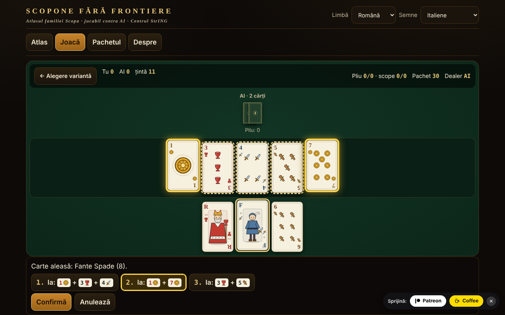

# Scopone fără frontiere

Atlas al familiei Scopa/Scopone cu pachetul italian de 40 de cărți: 8 variante jucabile contra AI, într-un singur fișier HTML offline.

**Live:** https://chiuta.github.io/Scopone-fara-frontiere/

## Ce este

Un atlas (15 fișe: origine, reguli, diferențe regionale, aproximări, surse) și un joc efectiv contra unui adversar AI local (euristic / Monte-Carlo, nu LLM). Semnele (Denari, Coppe, Spade, Bastoni) sunt desenate în SVG propriu, fără a copia pachete regionale; există și modul cu semne franceze ♦♥♠♣ pentru cine nu cunoaște pachetul.

## Funcții (verificate în cod și teste)

- Motor separat de interfață (funcții pure: stare → mutări legale → stare nouă), testat în Node.
- Generator exhaustiv de capturi legale (DFS cu tăiere), verificat cu enumerare brută 2^n.
- Selecția capturii: după alegerea unei cărți se pre-listează capturile posibile, cărțile de pe masă sunt evidențiate; la mai multe combinații alegi tu; poți și bifa cărți pe masă (validare: selecția trebuie să fie o captură legală).
- Tastatură completă: ← → cărți, Enter/Spațiu selectează, ↑ ↓ sau 1–9 aleg captura, Enter confirmă, Esc anulează.
- Scorare: scope, carte, denari, settebello, primiera (7=21, 6=18, As=16, 5=15, 4=14, 3=13, 2=12, figuri=10; fără un semn nu se punctează), opțional Re bello și Napola/Napoleone; Cirulla: bonusuri de mână/dealer, piccola, grande, cappotto.
- Interfață în 7 limbi (RO/EN/FR/IT/ES/PT/DE) cu autodetecție; textele lungi din atlas: RO + EN (în FR/IT/ES/PT/DE se afișează engleza, cu nota „text în engleză”). Paritatea cheilor e verificată cu script.
- Amestec cu `crypto.getRandomValues` (rejection sampling) sau seed reproductibil (mulberry32).
- Accesibilitate: aria-live, focus vizibil, ținte ≥44 px (cu excepția pastilei fixe de donații din subsol, copiată din serie), contrast ≥4,5:1 (măsurat), `prefers-reduced-motion`, 390 px fără scroll orizontal, `<noscript>`.

## Variante

| Nume | Jucabil? | ⚠ Aproximări |
|---|---|---|
| Scopa (2 jucători) | da | — (fidel Pagat; „chiamarsi fuori” lipsește) |
| Scopone 9 cărți + 4 pe masă (4 jucători în perechi) | da | ⚠ doar DENUMIREA e disputată între surse (vezi mai jos); regulile sunt cele din surse |
| Scopone 10 cărți, masa goală (4 jucători) — „scientifico” la Pagat/Aranzulla, „a 10 carte” la Wikipedia | da | ⚠ doar DENUMIREA e disputată; scopa la ultima carte: opțiune (implicit nu se numără) |
| Scopa a 15 (versiunile a și b din Pagat; b = carte egală, set de aceeași valoare sau set care face 15) | da | versiunea 3 și „minimum de cărți” doar în atlas |
| Asso piglia tutto | da | ⚠ cu mai mulți ași pe masă, asul ia unul la alegere (Pagat nu spune) |
| Scopa d'assi (4 jucători, 10 cărți) | da | ⚠ sursele diferă în detalii |
| Cirulla | da | ⚠ bonusuri declarate automat; piccola/grande după un singur rezumat |
| Rubamazzo | da | ⚠ reguli regionale variabile, AI simplu |
| Scopa Bazzica, scalette/Napola, Sbarazzina/Piva, Scopa corsă, Chkobba, Hurrikan, Cicera/Cirullone | doar în atlas | — |

Despre denumiri: „9 cărți fiecare și masa goală” e imposibil (4×9=36). Există două jocuri: 9 cărți + 4 pe masă și 10 cărți cu masa goală. Pagat și un ghid italian (Aranzulla) numesc „Scopone scientifico” varianta cu 10 cărți; Wikipedia italiană și engleză numesc „scientifico” varianta 9+4 și „Scopone a 10 carte” pe cea cu 10. De aceea aplicația le etichetează după numărul de cărți și le marchează ⚠. Punctele pe mână nu însumează un total constant de 11; „11” este ținta jocului (opțional 21).

## Manual de utilizare

1. Din fila „Atlas” citiți fișa unei variante și apăsați „▶ Joacă”, sau mergeți în „Joacă”.
2. Alegeți varianta, nivelul AI, ținta, opțiunile de regulă; „Seed” gol = amestec aleator. „▶ Începe meciul”.
3. În rândul dumneavoastră alegeți o carte din mână; capturile posibile apar jos și se evidențiază pe masă. Alegeți una (clic, ↑↓ sau cifra) și apăsați „Confirmă” / Enter. Dacă nu există captură, cartea se pune pe masă. Captura este obligatorie când e posibilă.
4. La sfârșitul mâinii apare tabelul de puncte; „Mâna următoare” sau „Meci nou”.
5. Opțional: „Arată mâinile AI” (doar învățare) și „Arată cărțile ieșite” (ajutor de memorie).

## AI (descriere onestă)

Nu este un LLM. „Euristic”: valoare pe mutare + estimarea riscului de scopa din cărțile nevăzute. „Monte-Carlo”: determinizare (distribuții posibile ale cărților nevăzute) + simulări cu politică euristică. AI-ul primește doar o observație (masa, mâna proprie, pliurile, numărul de cărți ale celorlalți): testul verifică că observațiile și deciziile sunt identice când cărțile ascunse sunt permutate. Măsurat (audit independent, 40 de eșantioane cu buget determinist de muncă, meciuri cu locurile alternate, MC contra euristic): Scopa 136/200 (68% ±6,5), Scopone 9+4 103/160 (64% ±7,4), Scopone 10 cărți 90/160 (56% ±7,7 — avantaj nedemonstrat statistic), Cirulla 100/150 (67% ±7,5), Scopa d'assi 128/200 (64% ±6,7), Scopa a 15 132/200 (66% ±6,6), Asso piglia tutto 130/200 (65% ±6,6; ultimele trei cu un buget puțin mai mare); euristicul bate un adversar aleatoriu 185/200 la Scopa. Nu este un jucător de nivel de turneu. (Atenție: cu 10 eșantioane per mutare, MC pierdea la Scopone — 38% și 31%; de aceea sunt acum până la 40, limitate de un buget de muncă: în Chromium ~99% din mutări sub ~115 ms, rar un vârf de ~200 ms.)

## Teste (în afara pachetului)

53 de teste de motor (inclusiv 500 de meciuri AI vs AI pe fiecare din cele 7 variante cu mutări validate la fiecare pas, invariantul de 40 de cărți, scor comparat cu o implementare independentă, 60 000 de comparații generator vs enumerare brută), 17 teste UI Playwright (meci complet prin UI pentru fiecare variantă, CSP, rețea, mobil, tastatură, contrast, localStorage blocat) și paritatea i18n.

## Confidențialitate și rețea

Fără rețea, cont sau telemetrie; CSP strict (`default-src 'none'`, script permis doar prin hash SHA-256, fără `connect-src`). `localStorage` (în try/catch) doar pentru limbă, pachet, ultima variantă, statistici locale. Linkurile Patreon/Coffee din footer se deschid doar la clic (`rel=noopener`).

## Limite și avertismente

- Regulile au fost citite din Pagat.com, Wikipedia italiană și ghiduri italiene; regulamentul Federației Italiene Scopone nu a putut fi consultat.
- Unde sursele diferă (denumiri Scopone/scientifico — verificate în Pagat, Aranzulla, Sisal, Wikipedia IT/EN; ținta 11 vs 21; scopa la ultima carte) fișa spune ce s-a implementat; opțiunile sunt expuse.
- Cirulla și Rubamazzo au ⚠ aproximări; AI-ul nu e de turneu.
- Cărțile sunt desene originale, nu reproduc pachete regionale.

## Surse

pagat.com/fishing/scopa.html · scopone.html · cirulla.html · it.wikipedia.org (Scopone scientifico, Rubamazzetto) · en.wikipedia.org (Scopone) · aranzulla.it (Scopone scientifico) · sisal.it (Scopone) · qualcherisposta.it (Rubamazzo).

## Rulare locală

Descărcați `index.html` și deschideți-l în browser; funcționează fără internet.

## Licență

nedeclarată — decizia autorului

## Autor

Alexio — Alexandru-Ionuț Chiuță · alexio@trom.tf

## English summary

Single-file offline atlas of the Scopa/Scopone family with a 40-card Italian pack (original SVG suits, French-suit mode): 8 variants playable against a local AI (Scopa, Scopone 9+4 ⚠name, Scopone 10-card ⚠name — sources disagree which one is "scientifico", Scopa a 15, Asso piglia tutto ⚠, Scopa d'assi ⚠, Cirulla ⚠, Rubamazzo ⚠), 7 atlas-only. UI in 7 languages, long texts RO+EN. Exhaustive legal-capture generator verified against brute force; 500 AI-vs-AI matches per variant without violations. No network, no telemetry. License undeclared.
